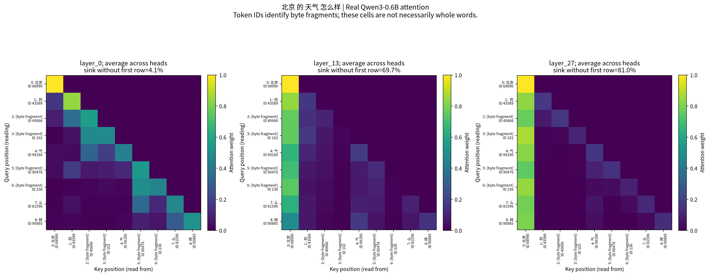
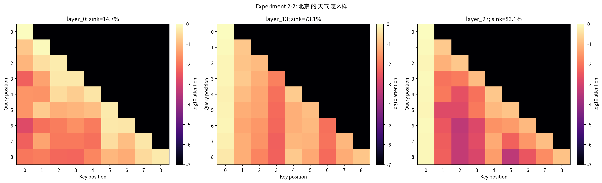
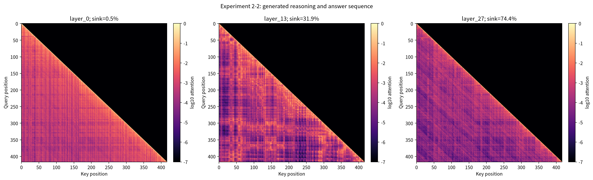

# Qwen3 注意力机制可视化：实验 2-2 独立复现

本仓库复现《深入理解 AI Agent：设计原理与工程实践》的**实验 2-2：注意力机制可视化**。使用本地 Qwen3-0.6B 真实推理，捕获第 0、13、27 层的注意力，保存矩阵、热力图和可独立核验的结果。

代码来源于 [bojieli/ai-agent-book](https://github.com/bojieli/ai-agent-book)，固定上游提交为 [`dbc046eb896ac4e39aa19c7774c8bf49583b89a6`](https://github.com/bojieli/ai-agent-book/tree/dbc046eb896ac4e39aa19c7774c8bf49583b89a6/chapter2/attention_visualization)。本仓库保留上游的 Apache-2.0 许可证和 Bojie Li 署名，新增独立运行、下载、验证入口及本次实验结果。详见 [LICENSE](LICENSE) 和 [NOTICE](NOTICE)。

**已完成的真实运行**

结果保存在 [`results/20261013T121659009239Z/`](results/20261013T121659009239Z/)。本次使用 Windows、Python 3.12.6、CPU float32 和 8 个计算线程，完整实验耗时 **99.812 秒**，不含安装依赖与下载模型；**15 项验收检查全部通过**。

| 项目 | 本次结果 |
| --- | --- |
| 模型 | `Qwen/Qwen3-0.6B`，28 层、每层 16 个注意力头 |
| 固定模型 revision | `c1899de289a04d12100db370d81485cdf75e47ca` |
| 基础提示词 | `北京 的 天气 怎么样`，不添加 chat template |
| 基础序列 | 9 个 token；第 0、13、27 层各保存一个 `9 × 9` 头平均矩阵 |
| 生成任务 | `17 × 23`；最终答案为 `17 × 23 = 391。` |
| 生成长度 | 提示词 48 个 token，新生成 369 个 token，总计 417 个 token |
| 生成序列矩阵 | 第 0、13、27 层各保存一个 `417 × 417` 头平均矩阵 |
| 结束方式 | 正常 EOS，非 token 上限截断 |
| 数值检查 | 矩阵有限、非负；上三角全为 0；行和最大误差约 `2.38 × 10⁻⁷` |

基础提示词中，首位置获得的平均注意力随层变化如下。此处**排除了首行**：首行只能关注自身，权重为 1，将它纳入短序列均值会抬高结果。

| 层索引（从 0 开始） | 首位置平均注意力，排除首行 |
| --- | ---: |
| 0 | 4.0594% |
| 13 | 69.6856% |
| 27 | 81.0261% |

**查看三张图**

下面这张基础图带有位置、token ID 和可读标签。行是 Query 位置，列是 Key 位置；亮色表示较高权重。一个 token 可能只包含某个汉字的部分 UTF-8 字节，因此部分位置标为 `[byte fragment]`，不能把每个格子当成一个完整汉字或词。



下图使用统一的 `log10 attention` 色标，方便观察较小的注意力权重。色标下限为 `10⁻⁷`，图中的下限颜色也包含真实的零值；因果上三角是否为零由原矩阵数值校验确定。



生成任务先得到真实输出，再对完整的 417-token 序列执行 eager forward，捕获以下注意力图。提示词、模型生成过程与最终答案的 token 范围记录在 `evidence.json` 中。



**从头运行**

需要 Python 3.12。模型首次下载约 **1.5 GB**；模型在本地运行，不需要 LLM API Key，也不产生 LLM API 调用费用。仓库不包含模型权重或 API Key。

Windows PowerShell 中，在仓库根目录依次执行：

```powershell
git clone https://github.com/shuklamohd675-lang/qwen3-attention-visualization.git
cd qwen3-attention-visualization
py -3.12 -m venv .venv

.\.venv\Scripts\python.exe -m pip install torch==2.13.0 --index-url https://download.pytorch.org/whl/cpu
.\.venv\Scripts\python.exe -m pip install -r requirements.txt

.\.venv\Scripts\python.exe download-model.py
.\.venv\Scripts\python.exe run-chapter2-attention.py --device cpu
```

已激活虚拟环境时，对应命令为：

```bash
python -m pip install torch==2.13.0 --index-url https://download.pytorch.org/whl/cpu
python -m pip install -r requirements.txt
python download-model.py
python run-chapter2-attention.py --device cpu
```

Windows 也可以在完成依赖安装和模型下载后使用包装脚本：

```powershell
.\run-chapter2-attention.ps1 -Device cpu
```

`requirements.txt` 固定了主要直接依赖，配合单独安装的 CPU PyTorch 对应本次运行环境；它不是涵盖所有平台和传递依赖的完整锁文件。本次关键版本为 PyTorch 2.13.0、Transformers 5.14.1、NumPy 1.26.4 和 Matplotlib 3.11.1。其他硬件、依赖版本或运行条件可能产生数值及耗时差异。

默认完整运行会处理北京原句、执行最多 640 个新 token 的确定性生成，并检查两个阶段的矩阵和生成区域。新结果写入 `.local/attention/<UTC 时间戳>/`，不会覆盖仓库中保留的结果。

仅观察北京提示词可使用：

```bash
python run-chapter2-attention.py --device cpu --quick
```

`--quick` 是局部运行：即使基础矩阵检查成功，其实验状态仍为 `partial`，不代表完整实验通过。对应的 Windows 参数为 `-Quick`。

下载器和 Python 入口默认使用**仓库父目录下的 `.cache/huggingface`** 作为 `HF_HOME`。需要自定义缓存时，先设置 `HF_HOME`，再通过 Python 入口下载和运行。PowerShell 包装脚本目前会将缓存固定为上述默认位置，因此自定义缓存请直接使用 Python 入口。

```powershell
$env:HF_HOME = Join-Path $PWD '.model-cache'
.\.venv\Scripts\python.exe download-model.py
.\.venv\Scripts\python.exe run-chapter2-attention.py --device cpu
```

**独立核验已有结果**

无需下载模型、重跑推理或访问模型 API，运行以下命令即可检查仓库附带的结果：

```bash
python verify-results.py
```

验证器默认检查 `results/20261013T121659009239Z/`，仅需 NumPy 和 Python 标准库。可在仅安装 `numpy==1.26.4` 的环境中运行。核验内容包括 manifest 文件哈希、验收状态、矩阵形状及数值约束。

保留的结果共 9 个文件：

| 文件 | 内容 |
| --- | --- |
| `attention_matrices.npz` | 六个 float32 头平均矩阵，以 NPZ 无损保存 |
| `beijing_attention_layers.png` | 北京提示词三层比较，对数色标 |
| `beijing_tokens_readable.png` | 北京提示词三层比较，带 token ID 与标签 |
| `reasoning_answer_attention_layers.png` | 完整生成序列三层比较 |
| `evidence.json` | 模型版本、环境、token、生成输出、区域和数值证据 |
| `experiment_protocol.json` | 原始实验协议 |
| `manifest.json` | 结果状态、验收门和产物 SHA-256 |
| `run_parameters.json` | 本次设备、精度、线程和生成参数 |
| `summary.json` | 精简运行摘要 |

附带结果的原始运行入口与当前入口使用同一实验逻辑：固定模型 revision、eager attention、原始北京提示词、三层捕获及确定性生成。源代码哈希保留在 `evidence.json` 中，用于追溯当时的实现；结果文件继续保留原始字节和 manifest，不将后续文档或打包改动伪装成原始运行。

**如何解释结果**

保存的是选定三层的**头平均注意力矩阵**，不是所有层、所有头的完整四维张量。注意力权重展示模型在这些位置上的信息读取分布，不能直接当成某个词对最终答案的因果贡献。

9-token 短句可以展示因果结构和本次运行中的首位置注意力集中现象，不能据此推断一般的长上下文位置偏好或不同模型的表现。验收也不要求某层达到预设的注意力比例：数值是观察结果，不是为了通过检查而设定的目标。
